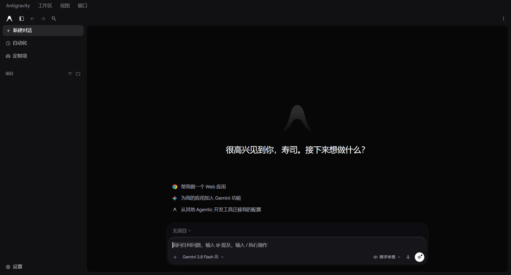
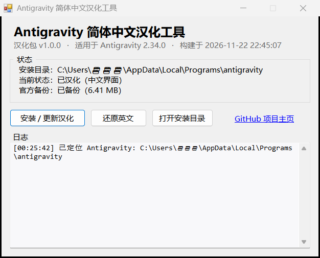

# Antigravity 简体中文汉化包

> 为 Google Antigravity 桌面客户端提供简体中文界面的社区汉化补丁。
> 不修改官方二进制、不联网、不收集任何数据；一键安装 / 一键还原。



## 目录

- [这是什么](#这是什么)
- [特性](#特性)
- [快速开始](#快速开始)
- [还原英文](#还原英文)
- [客户端更新后怎么办](#客户端更新后怎么办)
- [汉化范围](#汉化范围)
- [没有汉化的部分](#没有汉化的部分)
- [原理](#原理)
- [目录结构](#目录结构)
- [自行构建](#自行构建)
- [常见问题](#常见问题)
- [免责声明](#免责声明)
- [License](#license)

## 这是什么

Google Antigravity 的界面是一个由本地 language server 提供的纯英文 Web 应用，**官方没有内置任何 i18n 词条机制**，语言包无从挂载。

本项目逆向其 Electron 主进程结构后，在 `resources/app.asar` 的渲染进程 preload 末尾注入一段**运行时 DOM 翻译引擎**，配合人工整理的词典与句式规则，把界面文案实时替换为简体中文。

- 适用平台：Windows（10/11）
- 测试版本：Antigravity `2.34.0`（Electron `44.9.1` / Chrome `152`）
- 汉化包版本：`v1.0.0`（2026-11-22）

## 特性

| 项目 | 说明 |
| --- | --- |
| 词条规模 | **1907 条**人工整理词典 + **45 条**动态句式规则 |
| 覆盖界面 | 侧边栏、对话列表、项目、输入框、模型选择器、设置全部页签、权限/工具/网络规则、插件市场、弹窗与 tooltip |
| 动态内容 | 问候语（带用户名）、相对时间、数量单位、快捷键说明、`Delete "x"?` 之类模板句 |
| 无障碍 | `placeholder` / `title` / `aria-label` / `aria-description` 等属性一并翻译 |
| 安全隔离 | 主动跳过代码编辑器、`pre/code`、终端、可编辑输入框，不污染代码与输入 |
| 可还原 | 安装时自动备份官方 `app.asar`，一条命令还原 |
| 零依赖 | 单文件 exe 版不依赖 PowerShell / Python；脚本版只需系统自带 PowerShell 5.1 |
| 更新自愈 | 客户端自动更新后重新运行安装脚本即可，脚本会自动识别新官方版本 |

## 快速开始

### 方式一：单文件 exe（推荐，零依赖）

1. 到 [Releases](../../releases) 下载 `Antigravity-ZH-Installer.exe`（约 6.3 MB，汉化文件已内嵌，不需要 PowerShell / Python）。
2. 双击运行，程序会自动定位 Antigravity 并显示当前状态（已汉化 / 官方原版 / 已备份）。
3. 点「安装 / 更新汉化」，剩下的关闭客户端、备份、写入、重启全自动完成。



也支持命令行静默执行（便于脚本或批量部署）：

| 参数 | 作用 |
| --- | --- |
| `--install` | 静默安装 / 更新汉化 |
| `--restore` | 静默还原官方英文 |
| `--status` | 只检测状态 |
| `--help` | 显示帮助 |

日志写入 `%TEMP%\antigravity-zh.log`。

### 方式二：脚本版（zip）

1. 到 [Releases](../../releases) 下载 `Antigravity-zh-CN-v1.0.0.zip`。
2. **完整解压**（不要只把 `.cmd` 拖出来）。
3. 双击 `安装汉化.cmd`，脚本会自动关闭客户端 → 备份 → 写入 → 重启。
4. 界面即为简体中文。

### 方式三：直接用本仓库

```powershell
git clone https://github.com/<your-name>/antigravity-zh.git
cd antigravity-zh\installer
.\安装汉化.cmd
```

> 若 PowerShell 拦截脚本，右键 `install.ps1` → 属性 → 勾选“解除锁定”，或执行
> `powershell -ExecutionPolicy Bypass -File .\install.ps1`。

安装脚本会：

1. 自动定位 Antigravity（注册表 + 常见安装路径，找不到时让你粘贴路径）；
2. 关闭正在运行的客户端；
3. 把官方 `resources\app.asar` 备份为 `resources\app.asar.zh-backup`（已存在则不覆盖）；
4. 写入汉化后的 `app.asar`；
5. 重新启动客户端。

## 还原英文

双击 `还原英文.cmd`，脚本会用 `app.asar.zh-backup` 覆盖回去并重启客户端。

> 备份文件位于 `…\Programs\antigravity\resources\app.asar.zh-backup`，请勿删除。

## 客户端更新后怎么办

Antigravity 每次自动更新都会覆盖 `resources\app.asar`，界面会变回英文。**重新双击一次 `安装汉化.cmd` 即可**。

脚本通过 SHA256 识别三种状态：

| 当前 app.asar | 脚本行为 |
| --- | --- |
| 与汉化包一致 | 判定“已安装”，直接启动 |
| 与制作时的官方版本一致 | 备份并安装 |
| 其他（客户端已升级） | 提示版本不一致，确认后仍然安装（新文案可能仍是英文） |

## 汉化范围

- **主界面**：新建对话、自动化、定制项、项目、对话历史、搜索、侧边栏自定义
- **输入区**：占位提示、模型选择器、请求审查模式、语音按钮、队列消息
- **设置**：常规 / 应用程序 / 外观 / 快捷键 / 通知 / 模型 / 浏览器 / 对话，含全部说明文字
- **智能体**：权限预设、工具权限、文件与网络访问规则、钩子、技能、子智能体
- **插件市场**：插件包、插件详情、账号与连接器状态
- **杂项**：右键菜单、确认弹窗、错误提示、tooltip、空状态文案

部分效果见 [`screenshots/`](screenshots)。

## 没有汉化的部分

以下内容**故意保持原文**，避免破坏功能或污染内容：

- 代码编辑器（Monaco）、终端输出、聊天记录正文、你自己的输入
- 模型名称（如 `Gemini 3.8 Flash`）、插件/技能内部标识（如 `swarm_monitor`）、字体名
- 键名（`Ctrl` / `Shift` / `Enter`）、邮箱、路径
- 窗口最上方由操作系统绘制的原生菜单栏

## 原理

```
resources/app.asar
├─ dist/main.js        Electron 主进程（未修改）
├─ dist/preload.js     ← 末尾追加汉化引擎（约 78 KB）
└─ dist/zh-build.json  构建信息（词条数、构建时间）
```

1. **打包层**：`src/build.py` 用纯 Python 解析 asar 头部与数据偏移，把引擎追加进 `preload.js`，再按 asar 规范重新写出（保留 `unpacked` 标记、重算偏移、逐文件 SHA256 校验）。Antigravity 的 `EnableEmbeddedAsarIntegrityValidation` fuse 为关闭状态，因此重打包安全。
2. **运行层**：`preload.js` 在隔离世界中运行，仅操作 DOM：
   - 精确匹配优先（词典 → 大小写变体 → `Key:` 形式 → 正则句式）；
   - `MutationObserver` 监听新增节点与属性变化，首屏另有 20 秒补扫；
   - 维护“自己写过的值”白名单，避免与 React 互相触发死循环；
   - 翻译失败静默跳过，绝不抛异常中断页面。
3. **验证**：`tools/` 下的脚本通过 Chrome DevTools Protocol 连进渲染进程，逐屏扫描未翻译文案并截图比对。

## 目录结构

```
antigravity-zh/
├─ installer/            安装 / 还原脚本（Windows）
│  ├─ 安装汉化.cmd
│  ├─ install.ps1
│  ├─ 还原英文.cmd
│  └─ uninstall.ps1
├─ src/exe/              单文件安装器（C# 源码、图标、build.ps1）
├─ dist/                 已构建产物
│  ├─ app.zh.asar        汉化后的 app.asar（约 6.3 MB）
│  └─ manifest.json      版本与 SHA256 校验
├─ src/                  构建源码
│  ├─ build.py           asar 解析 / 重打包
│  ├─ engine_body.js     DOM 翻译引擎
│  ├─ rules.json         动态句式规则
│  └─ dict/p1..p7.json   词典（1907 条）
├─ tools/                CDP 验证工具
├─ docs/说明.txt         面向普通用户的中文说明
└─ screenshots/          效果截图
```

## 自行构建

需要 Python 3.10+ 与已安装的 Antigravity。

```powershell
# 1. 首次安装后会自动生成官方备份 app.asar.zh-backup
cd antigravity-zh\src
python build.py            # 生成 app.zh.asar 并逐文件校验
python build.py --install  # 校验通过后直接安装
python build.py --restore  # 用备份还原官方文件
```

`build.py` 始终以 `app.asar.zh-backup`（官方原版）作为输入，避免在已汉化的文件上重复注入。

添加词条：在 `src/dict/` 新建 `p8.json`（`{"English": "中文"}`），重新运行 `build.py` 即可。
动态句式：在 `src/rules.json` 里按 `[正则, 替换]` 追加，支持 `$1` 捕获组。

## 常见问题

**Q：安装后界面还是英文？**
A：确认客户端进程已完全退出后重新运行安装脚本；若在设置里改过界面语言，与汉化无关，汉化只替换英文文案。

**Q：客户端打不开 / 白屏？**
A：运行 `还原英文.cmd`。若仍异常，卸载重装 Antigravity（不影响账号与对话数据）。

**Q：会不会影响自动更新或触发风控？**
A：不修改二进制、不改签名、不联网。更新机制只看版本号与官方 URL，与本补丁无关；但**更新会覆盖补丁**，需要重装汉化。

**Q：macOS / Linux 能用吗？**
A：脚本目前只写了 Windows 路径探测；asar 结构相同，`build.py` 是跨平台的，理论上替换 `resources/app.asar` 即可，欢迎提交 PR。

## 免责声明

本项目为非官方社区汉化，与 Google 无任何关联。所有商标与原始文案版权归 Google 所有。补丁仅修改本地安装目录中的界面文案，不分发官方二进制、不绕过任何授权与计费、不收集用户数据。请自行评估风险，建议在安装前保留官方备份（脚本会自动完成）。

## License

[MIT](LICENSE) © 2026 Antigravity Chinese Pack contributors

---

## English

Community Simplified-Chinese localization for the **Google Antigravity** desktop client (Windows).

The app ships an English-only web UI with no i18n hooks, so this project injects a runtime DOM translation engine into the renderer preload inside `resources/app.asar` — 1,907 hand-curated entries plus 45 regex rules, with code/terminal/editor areas explicitly skipped.

**Install:** unzip a release, double-click `安装汉化.cmd` (install) or `还原英文.cmd` (restore).
**After an app update:** run the installer again.
**Not affiliated with Google.** MIT licensed.
